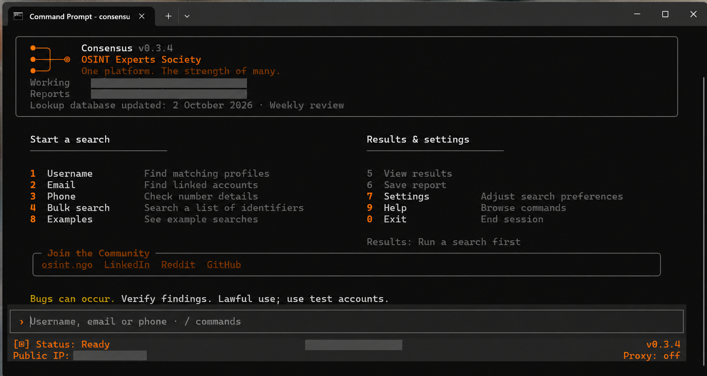
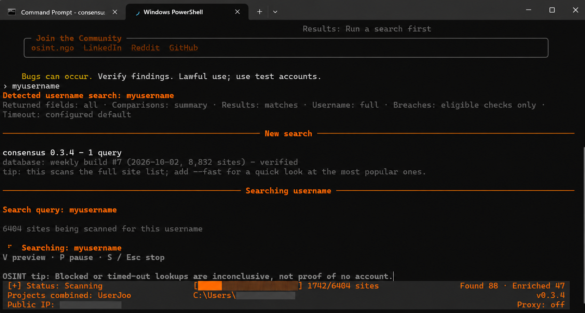

<p align="center">
  <picture>
    <source media="(prefers-color-scheme: dark)" srcset="consensus_osint/templates/consensus-wordmark-dark.svg">
    <source media="(prefers-color-scheme: light)" srcset="consensus_osint/templates/consensus-wordmark-light.svg">
    
  </picture>
</p>

<h3 align="center">Usernames. Emails. Phone Numbers. 19 Projects. One Tool.</h3>

<p align="center">By the <a href="https://osint.ngo">OSINT Experts Society</a></p>

<p align="center">A unified lookup tool combining 7,900+ modules from 19 open-source projects, reviewed and updated weekly by our experts.</p>

<p align="center"><a href="#install"><strong>Install</strong></a> &middot; <a href="#key-features">Features</a> &middot; <a href="#compare">Compare</a> &middot; <a href="#see-consensus-in-action">See it in action</a></p>

<p align="center">
  <picture>
    <source media="(max-width: 600px) and (prefers-color-scheme: dark)" srcset="consensus_osint/templates/consensus-process-dark-mobile.svg">
    <source media="(max-width: 600px)" srcset="consensus_osint/templates/consensus-process-light-mobile.svg">
    <source media="(prefers-color-scheme: dark)" srcset="consensus_osint/templates/consensus-process-dark.svg">
    
  </picture>
</p>

<p align="center">
  <a href="#compare"></a>
  <a href="#key-features"></a>
  <a href="LICENSE"></a>
  <a href="CONTRIBUTING.md"></a>
</p>

<p align="center">
  <a href="https://osint.ngo"></a>
  <a href="https://www.linkedin.com/groups/13047129/"></a>
  <a href="https://www.reddit.com/r/OSINTExperts/"></a>
</p>

<details>
<summary>Compare Consensus with its 19 source projects</summary>
<a id="compare"></a>

<p align="center"><strong>Combined coverage. Maintained modules. Consistent results.</strong><br>One installation and update process replaces managing separate tools and reconciling their results.</p>

<div align="center">
<table align="center">
  <thead>
    <tr><th align="left">Tool</th><th align="center">Username</th><th align="center">Email</th><th align="center">Phone</th><th align="center">Duplicate<br>ratio*</th><th align="center">Update<br>frequency*</th><th align="center">Last&nbsp;module<br>update</th></tr>
  </thead>
  <tbody>
    <tr><td align="left"><picture><source media="(prefers-color-scheme: dark)" srcset="consensus_osint/templates/consensus-wordmark-dark.svg"></picture><br><strong>Combined solution</strong></td><td align="center"><strong>7,782</strong></td><td align="center"><strong>205</strong></td><td align="center"><strong>2</strong></td><td align="center"><strong>Deduplicated</strong><br><sub>default searches*</sub></td><td align="center"><strong>Weekly<br>expert review</strong></td><td align="center">02&nbsp;Oct&nbsp;2026</td></tr>
    <tr><td align="left"><a href="https://github.com/soxoj/maigret/tree/b6642744988e7e6c2d21f75db60ec3093019ba25">Maigret</a></td><td align="center">5,483</td><td align="center">—</td><td align="center">—</td><td align="center"><strong>40.8%</strong><br><sub>5,482/5,483&nbsp;mapped</sub></td><td align="center">Every&nbsp;2&nbsp;days</td><td align="center"><a href="https://github.com/soxoj/maigret/commit/3d2b613cfd9a18bebc9d65bb22bcf8af13aa18ef">25&nbsp;Sep&nbsp;2026</a></td></tr>
    <tr><td align="left"><a href="https://github.com/kaifcodec/user-scanner/tree/780d077a468035c6afd6b4a0f987317db651528b">User Scanner</a></td><td align="center">2,511</td><td align="center">211</td><td align="center">—</td><td align="center"><strong>68.9%</strong><br><sub>2,575/2,722&nbsp;mapped</sub></td><td align="center">Every&nbsp;1&nbsp;day</td><td align="center"><a href="https://github.com/kaifcodec/user-scanner/commit/8f4de8e7b3e68672c50ba318b2d15a9d2b4617e9">29&nbsp;Sep&nbsp;2026</a></td></tr>
    <tr><td align="left"><a href="https://github.com/arxhr007/Aliens_eye/tree/b1316648fe0e648469d30512bb0535ebc8c4bbc7">Aliens Eye</a></td><td align="center">840</td><td align="center">—</td><td align="center">—</td><td align="center"><strong>65.4%</strong><br><sub>837/840&nbsp;mapped</sub></td><td align="center">Too few updates</td><td align="center"><a href="https://github.com/arxhr007/Aliens_eye/commit/eb10623492e1e171ff2d7d9cfc043a4a0a0e493a">10&nbsp;Jun&nbsp;2026</a></td></tr>
    <tr><td align="left"><a href="https://github.com/WebBreacher/WhatsMyName/tree/062bcfe48df79fa618e96edc79dc9673f3fe5643">WhatsMyName</a></td><td align="center">716</td><td align="center">—</td><td align="center">—</td><td align="center"><strong>60.8%</strong><br><sub>716/716&nbsp;mapped</sub></td><td align="center">Every&nbsp;3.5&nbsp;days</td><td align="center"><a href="https://github.com/WebBreacher/WhatsMyName/commit/062bcfe48df79fa618e96edc79dc9673f3fe5643">16&nbsp;Sep&nbsp;2026</a></td></tr>
    <tr><td align="left"><a href="https://github.com/sherlock-project/sherlock/tree/e40a45ec2a074b90703b3b4b842c8a3adbd6ada3">Sherlock</a></td><td align="center">481</td><td align="center">—</td><td align="center">—</td><td align="center"><strong>98.5%</strong><br><sub>479/481&nbsp;mapped</sub></td><td align="center">Too few updates</td><td align="center"><a href="https://github.com/sherlock-project/sherlock/commit/dca64e35d36217335fb45373cde4891226aae182">28&nbsp;Apr&nbsp;2026</a></td></tr>
    <tr><td align="left"><a href="https://github.com/0xSaikat/findme/tree/85a860357f9b6a0df2dfb16ccd495fef93a5dfa1">FindMe</a></td><td align="center">412</td><td align="center">—</td><td align="center">—</td><td align="center"><strong>99.8%</strong><br><sub>410/412&nbsp;mapped</sub></td><td align="center">No updates<br>in 6 months</td><td align="center"><a href="https://github.com/0xSaikat/findme/commit/ce2d34c54ed109f56fe798cda6171ce1f93b331d">14&nbsp;Jan&nbsp;2025</a></td></tr>
    <tr><td align="left"><a href="https://github.com/Yvesssn/DetectDee/tree/551817c911ddf3a25eba9d4addb56df1e15b8f2b">DetectDee</a></td><td align="center">375*</td><td align="center">3*</td><td align="center">4*</td><td align="center"><strong>82.5%</strong><br><sub>380/382&nbsp;mapped</sub></td><td align="center">No updates<br>in 6 months</td><td align="center"><a href="https://github.com/Yvesssn/DetectDee/commit/6f54e661f2afdfe2a297dd54ee7d7cbab476dbca">19&nbsp;Jul&nbsp;2023</a></td></tr>
    <tr><td align="left"><a href="https://github.com/thewhiteh4t/nexfil/tree/c540238dd510b865daac1eb59a328f8fa68b1ce5">Nexfil</a></td><td align="center">328</td><td align="center">—</td><td align="center">—</td><td align="center"><strong>89.3%</strong><br><sub>327/328&nbsp;mapped</sub></td><td align="center">No updates<br>in 6 months</td><td align="center"><a href="https://github.com/thewhiteh4t/nexfil/commit/f1249e15baf453bb807fff03f75c73b993b71210">14&nbsp;Aug&nbsp;2023</a></td></tr>
    <tr><td align="left"><a href="https://github.com/ibnaleem/gosearch/tree/8c41d1e7f0fad9cb4bf9fb11f5bb096c90ac9027">GoSearch</a></td><td align="center">306</td><td align="center">—</td><td align="center">—</td><td align="center"><strong>92.6%</strong><br><sub>306/306&nbsp;mapped</sub></td><td align="center">Every&nbsp;47&nbsp;days</td><td align="center"><a href="https://github.com/ibnaleem/gosearch/commit/8c41d1e7f0fad9cb4bf9fb11f5bb096c90ac9027">30&nbsp;Sep&nbsp;2026</a></td></tr>
    <tr><td align="left"><a href="https://github.com/krishpranav/vesper/tree/6f861692d7a37b5d001ce188477fc65854566043">Vesper</a></td><td align="center">299</td><td align="center">—</td><td align="center">—</td><td align="center"><strong>96.6%</strong><br><sub>298/299&nbsp;mapped</sub></td><td align="center">No updates<br>in 6 months</td><td align="center"><a href="https://github.com/krishpranav/vesper/commit/0f08adab6485fcce8f4d74f638cde56127746a3b">20&nbsp;Jun&nbsp;2021</a></td></tr>
    <tr><td align="left"><a href="https://github.com/n0tr00t/Sreg/tree/ed11d094d490b4732239ad8715f3734bfd7e91a7">Sreg</a></td><td align="center">51*</td><td align="center">50*</td><td align="center">50*</td><td align="center">Not comparable</td><td align="center">No updates<br>in 6 months</td><td align="center"><a href="https://github.com/n0tr00t/Sreg/commit/64a831ea412b911971eaa4a7732a2527ddb0d244">23&nbsp;Mar&nbsp;2015</a></td></tr>
    <tr><td align="left"><a href="https://github.com/megadose/holehe/tree/14da70f588538936b20d238783c5e28a0772a2b3">Holehe</a></td><td align="center">—</td><td align="center">123</td><td align="center">—</td><td align="center"><strong>28.5%</strong><br><sub>123/123&nbsp;mapped</sub></td><td align="center">No updates<br>in 6 months</td><td align="center"><a href="https://github.com/megadose/holehe/commit/04efb43b9106a04b7afe80b2e5480cc4ef921710">24&nbsp;Jul&nbsp;2024</a></td></tr>
    <tr><td align="left"><a href="https://github.com/JackJuly/linkook/tree/1c893599886656c17bf4fe0dadfc1e2deb5c6b28">Linkook</a></td><td align="center">64</td><td align="center">—</td><td align="center">—</td><td align="center"><strong>96.9%</strong><br><sub>64/64&nbsp;mapped</sub></td><td align="center">Too few updates</td><td align="center"><a href="https://github.com/JackJuly/linkook/commit/ffd9f2a33a6ad740ec062c30b099cfe7a6d00298">30&nbsp;Sep&nbsp;2026</a></td></tr>
    <tr><td align="left"><a href="https://github.com/ar33s0/UserJoo/tree/01036cff670e5ddd197bc6fbcf25d45a810a2503">UserJoo</a></td><td align="center">29</td><td align="center">—</td><td align="center">—</td><td align="center"><strong>6.9%</strong><br><sub>29/29&nbsp;mapped</sub></td><td align="center">Every&nbsp;4&nbsp;days</td><td align="center"><a href="https://github.com/ar33s0/UserJoo/commit/b41f685cff4ec8ae5aacb8ed8fc29e14f50ea2c0">03&nbsp;Sep&nbsp;2026</a></td></tr>
    <tr><td align="left"><a href="https://github.com/iojw/socialscan/tree/5ae42d0f82b0ebd717b3ae52b693b4ececa902b1">Socialscan</a></td><td align="center">6</td><td align="center">6</td><td align="center">—</td><td align="center"><strong>91.7%</strong><br><sub>12/12&nbsp;mapped</sub></td><td align="center">No updates<br>in 6 months</td><td align="center"><a href="https://github.com/iojw/socialscan/commit/87a4512deb30d1ffd84584acca40168e5c10f203">21&nbsp;Jan&nbsp;2024</a></td></tr>
    <tr><td align="left"><a href="https://github.com/whoamitang/numint/tree/9186c35ad0836e8094bfa1a0e264fe6e01a82823">Numint</a></td><td align="center">—</td><td align="center">—</td><td align="center">5</td><td align="center"><strong>60.0%</strong><br><sub>5/5&nbsp;mapped</sub></td><td align="center">Too few updates</td><td align="center"><a href="https://github.com/whoamitang/numint/commit/ac36acb6b7a0a3ff0cc7778389184333a31e2230">12&nbsp;Jul&nbsp;2026</a></td></tr>
    <tr><td align="left"><a href="https://github.com/megadose/ignorant/tree/40b3eb734ef3d55e6d16eb314e49dbf520fa1f64">Ignorant</a></td><td align="center">—</td><td align="center">—</td><td align="center">3</td><td align="center"><strong>100.0%</strong><br><sub>3/3&nbsp;mapped</sub></td><td align="center">No updates<br>in 6 months</td><td align="center"><a href="https://github.com/megadose/ignorant/commit/b646cf086e8542ccfbeda951aee38fdd15d758a0">24&nbsp;Mar&nbsp;2021</a></td></tr>
    <tr><td align="left"><a href="https://github.com/hanyxd/sherlockV2">SherlockV2</a></td><td align="center" colspan="3">Unverified (repository unavailable)</td><td align="center">Unverified</td><td align="center">Unverified</td><td align="center">Unverified</td></tr>
    <tr><td align="left"><a href="https://github.com/sharsil/mailcat/tree/7f61a59b68c594ea894bfc364517f08d23b07752">Mailcat</a></td><td align="center" colspan="3">26 mailbox-provider checks*</td><td align="center">Not comparable</td><td align="center">Too few updates</td><td align="center"><a href="https://github.com/sharsil/mailcat/commit/7f61a59b68c594ea894bfc364517f08d23b07752">05&nbsp;Sep&nbsp;2026</a></td></tr>
  </tbody>
</table>
</div>

<details>
<summary align="center">About these counts (3 October 2026)</summary>

**Snapshot: 3 October 2026.** Counts include enabled rules and modules, not unique websites. Phone counts exclude number analysis and search links; an em dash means no comparable definitions.

Consensus's last module update is the date of its signed catalogue. The maintenance summary reports additions in the latest recorded intake; those implementation counts can include overlapping sites. Unrecorded repair or retirement totals are not presented as zero.

- **Duplicate ratio:** share of distinct mapped lookups also listed by another tool, excluding Consensus. Based on service + lookup type across 16 projects; fractions show definitions mapped. Incomplete mappings and unresolved aliases limit accuracy. Shared targets may return different information. Consensus deduplicates default searches; explicit selections and all-modules mode can retain alternatives.
- **Update frequency:** median days between lookup-file update dates, 3 April–3 October 2026. Same-day commits count once; merges, unrelated files and helper-only edits are excluded. At least three update days are required. This measures file edits, not releases. Consensus's weekly review is a schedule, not a measured interval.

*DetectDee counts declared rules despite malformed regex escapes. Sreg counts configured routes, often repeated across input types. Mailcat covers nickname-to-mailbox discovery. SherlockV2's repository was unavailable. Sreg, Mailcat and SherlockV2 are excluded from duplicate ratios.*

</details>

</details>

<!-- maintenance-summary:start -->
<p align="center">Last expert review: <strong>02 October 2026</strong> &middot; Latest intake: <strong>1,181 modules + 668 site rules added</strong></p>
<!-- maintenance-summary:end -->

## Key features

- **Expert review, every week.** Our team reviews all 19 source projects weekly and evaluates new OSINT projects as they emerge. Suitable modules are tested, improved and integrated; broken modules are retired.
- **Follow new leads automatically.** Enable recursive search to investigate usernames, email addresses and linked accounts discovered in your results, expanding your search without entering each new lead yourself.
- **Keep investigations current.** Search newly added lookup sources, or recheck saved identifiers and see newly discovered matches, changed details and inconclusive results.
- **Quick first results.** Username menu searches start with up to 300 site and module lookups. Continue the full search while retaining completed results.
- **Enriched results.** Go beyond found/not found with available profile details, including names, biographies and linked accounts. Inspect the returned information, see source coverage and compare details across results.
- **Reports and evidence graphs.** Export HTML, PDF, CSV or JSON; explore connections visually, with XMind and Neo4j exports also available.
- **Bulk search and advanced controls.** Process lists, generate username variations, filter sites and categories, and use proxies.
- **Save your investigation.** Keep named investigations with multiple saved searches, notes and relevant/unrelated decisions. Storage is local and explicit; optional recent-search history is separate.
- **Automatic update checks.** Managed installs check for updates at startup and notify you when an update is available or ready to use. Repair and rollback are built in.
- **AI integration.** Optional MCP support connects compatible assistants to Consensus lookups and results.

## See Consensus in action

Click any image to enlarge. Console screenshots have personal details redacted; report and graph examples use fictional data.

**Try the output before installing:** download the [example HTML report](https://github.com/OSINT-Experts-Society/Consensus-OSINT/raw/refs/heads/main/consensus_osint/templates/consensus-example-report.html) or [interactive graph](https://github.com/OSINT-Experts-Society/Consensus-OSINT/raw/refs/heads/main/consensus_osint/templates/consensus-example-graph.html), then open the saved HTML file in your browser. Both use fictional profiles and work offline.

**Start a search** — username, email, phone and bulk searches from one menu.

<a href="consensus_osint/templates/consensus-home-redacted.png"></a>

**Follow your search** — see progress, matches and enriched results; preview, pause or stop at any time.

<a href="consensus_osint/templates/consensus-search-redacted.png"></a>

**HTML report** — searchable findings, profile details and source coverage.

<a href="consensus_osint/templates/consensus-demo-report.png"></a>

**Interactive evidence graph** — explore connections and inspect the supporting evidence.

After a search, choose **Save report** and press **Enter**. Consensus saves both an HTML report and an interactive graph, with a separate link to open each in your browser.

<a href="consensus_osint/templates/consensus-demo-graph.png"></a>

## Install

Choose an installation option below.

**Quick install on Windows — no coding needed**

1. **Download:** open [Releases](https://github.com/OSINT-Experts-Society/Consensus-OSINT/releases), find **Assets**, and save the `Consensus-<version>.zip` installer to your Downloads folder.
2. **Extract it:** right-click the ZIP, select **Extract All**, then **Extract**.
3. **Install:** open the extracted folder, double-click **Install.cmd**, and wait for installation to finish. Keep your internet connection on.
4. **Open Consensus:** choose **Launch Consensus** when prompted, or press the Windows key, type **Consensus**, and open the Start menu shortcut.
5. **Start searching:** choose **Username**, **Email** or **Phone**, then enter what you want to look up.

For macOS, Linux or other installation methods, use the options below.

| Platform | Double-click installer | Install from terminal | Install from source |
| --- | --- | --- | --- |
| **Windows** | **Install.cmd** | Run `.\Install.cmd` in CMD or PowerShell. | [Git + Python instructions](#install-from-source) |
| **macOS / Linux** | Use the terminal option. | Run `sh install.sh`. | [Git + Python instructions](#install-from-source) |

**Recommended: the install bundle.** Both installer options set up Python and dependencies for you. Run terminal commands from the extracted folder. Internet access is required.

After a bundle install, open a new terminal:

```console
consensus
```

## Start searching

1. Choose **Username**, **Email**, **Phone** or **Bulk search**.
2. Enter your query. Include the country code for phone numbers.
3. Review matches, open enriched details, then **Save report**, **Filter results** or **Search again**.

Choose **I Follow up** in results to continue a full search, search new sources, recheck or view changes. Choose **8 Investigations** from the main menu to save searches and notes together. Newly discovered profiles are not necessarily newly created accounts; an unavailable result does not prove deletion.

Press **Esc** or **S** to stop an interactive scan; type `exit` to quit. Enable **Recent searches** in Settings to keep up to 10 searches locally. History is off by default.

<details>
<summary>Command-line examples</summary>

```console
consensus user "YOUR_USERNAME"
consensus email "YOUR_EMAIL"
consensus phone "+COUNTRY_CODE_AND_NUMBER"
consensus user "YOUR_USERNAME" -o reports/username.html
```

Explore more with `consensus --help` or `consensus examples`.

</details>

<details>
<summary>Updates, repair and migration</summary>

Open **Settings → Installation & updates** to check versions, install updates, restart or recover an installation.

To update from an installer ZIP, extract it, then select **Choose bundle** in Settings and choose the extracted folder, or run its installer. Restart to apply changes.

| Command | Action |
| --- | --- |
| `consensus update` | Install an available update. |
| `consensus update --repair` | Repair the installed version. |
| `consensus update --rollback` | Restore the previous version and pause automatic upgrades. |

A manual update resumes upgrades after rollback. Set `CONSENSUS_AUTO_UPDATE=0` for notifications only, or `CONSENSUS_NO_UPDATE_CHECK=1` to disable startup checks.

**Moving from a source install?** Choose **Switch to managed installation** in the Updates screen and select the extracted bundle. Your configuration and report locations are preserved.

</details>

## Install from source

Requires [Python 3.10+](https://www.python.org/downloads/) and [Git](https://git-scm.com/downloads).

```console
git clone https://github.com/OSINT-Experts-Society/Consensus-OSINT.git
cd Consensus-OSINT
python -m venv .venv
```

**Windows**

```console
.\.venv\Scripts\python.exe -m pip install ".[modules,pdf]"
.\.venv\Scripts\consensus.exe
```

**macOS / Linux**

Use `python3` above if required, then:

```console
.venv/bin/python -m pip install ".[modules,pdf]"
.venv/bin/consensus
```

Add `mcp` to the extras for AI integration, for example `".[modules,pdf,mcp]"`. PDF support is included in managed installs.

To update a source install, run `git pull`, then repeat its pip command above.

## Join the community

**Want your OSINT project included?** [Contact the Society](https://osint.ngo) for evaluation.

[Website](https://osint.ngo) · [LinkedIn](https://www.linkedin.com/groups/13047129/) · [Reddit](https://www.reddit.com/r/OSINTExperts/) · [Report an issue](https://github.com/OSINT-Experts-Society/Consensus-OSINT/issues)

Use responsibly. Shared details are leads, not proof of identity; verify important matches at their source.

[GPL-3.0-or-later](LICENSE) · [Third-party credits](THIRD_PARTY_NOTICES.txt) · [Legal & privacy](LEGAL.md)
