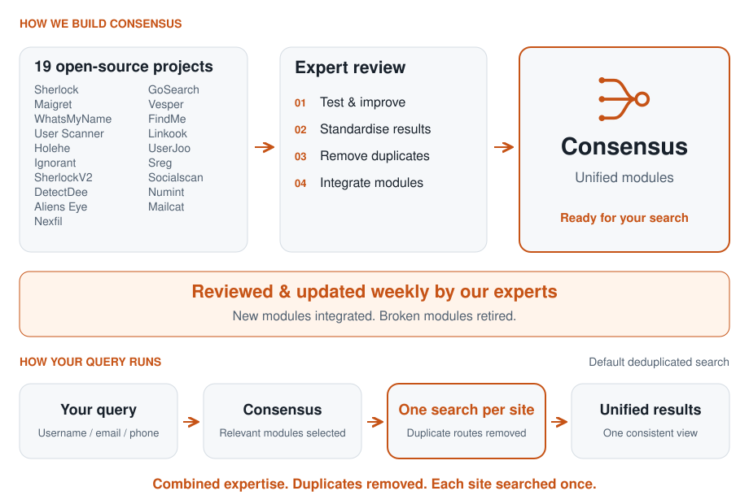
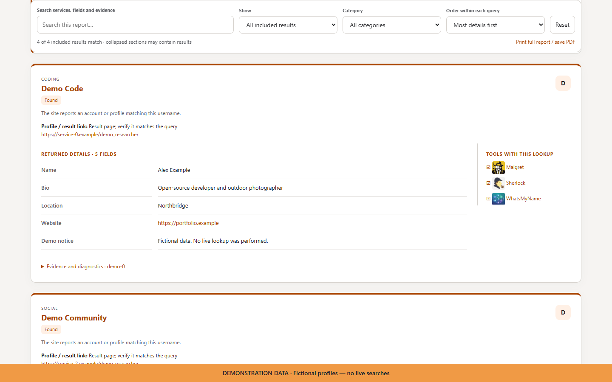
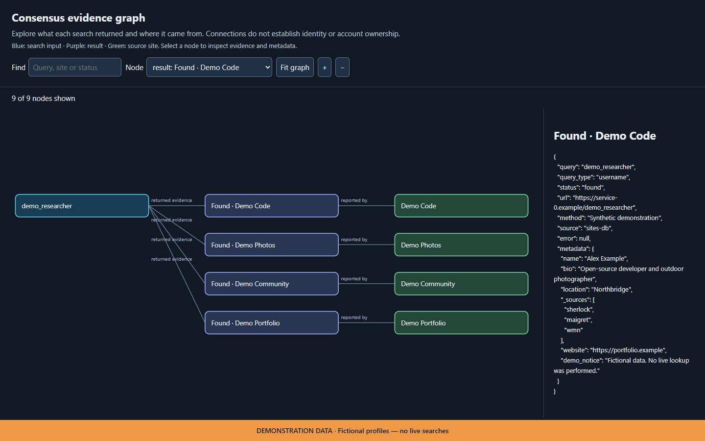

<p align="center">
  <picture>
    <source media="(prefers-color-scheme: dark)" srcset="consensus_osint/templates/consensus-wordmark-dark.svg">
    <source media="(prefers-color-scheme: light)" srcset="consensus_osint/templates/consensus-wordmark-light.svg">
    
  </picture>
</p>

<p align="center">By the <a href="https://osint.ngo">OSINT Experts Society</a></p>

<p align="center"><strong>7,900+ lookup modules. 19 open-source projects. One tool.</strong></p>

<p align="center"><a href="#install"><strong>Install</strong></a> &middot; <a href="#key-features">Features</a> &middot; <a href="#compare">Compare</a> &middot; <a href="#see-consensus-in-action">See it in action</a></p>

<p align="center">Expert-maintained username, email and phone intelligence, standardised into one tool. Each week, our experts review major open-source projects for new modules—deduplicating, testing, improving and integrating suitable additions, while retiring modules that no longer work.</p>

<p align="center"><strong>One installation. One search workflow. One consistent report across 19 source projects.</strong></p>

<p align="center">
  <picture>
    <source media="(max-width: 600px) and (prefers-color-scheme: dark)" srcset="consensus_osint/templates/consensus-process-dark-mobile.svg">
    <source media="(max-width: 600px)" srcset="consensus_osint/templates/consensus-process-light-mobile.svg">
    <source media="(prefers-color-scheme: dark)" srcset="consensus_osint/templates/consensus-process-dark.svg">
    
  </picture>
</p>

<p align="center">
  <a href="#compare"></a>
  <a href="#key-features"></a>
  <a href="LICENSE"></a>
  <a href="CONTRIBUTING.md"></a>
</p>

<p align="center">
  <a href="https://osint.ngo"></a>
  <a href="https://www.linkedin.com/groups/13047129/"></a>
  <a href="https://www.reddit.com/r/OSINTExperts/"></a>
</p>

<details>
<summary>Compare Consensus with its 19 source projects</summary>
<a id="compare"></a>

<p align="center"><strong>Overlapping sources. Separate update schedules. One combined solution.</strong></p>
<p align="center">Consensus brings these sources together, with expert review and updates every week. Default searches select one lookup per site and bring the results into one report.</p>

<div align="center">
<table align="center">
  <thead>
    <tr><th align="left">Tool</th><th align="center">Username</th><th align="center">Email</th><th align="center">Phone</th><th align="center">Duplicate<br>ratio*</th><th align="center">Update<br>frequency*</th><th align="center">Last&nbsp;module<br>update</th><th align="center">Failing<br>modules&nbsp;(%)*</th></tr>
  </thead>
  <tbody>
    <tr><td align="left"><picture><source media="(prefers-color-scheme: dark)" srcset="consensus_osint/templates/consensus-wordmark-dark.svg"></picture><br><strong>Combined solution</strong></td><td align="center"><strong>7,782</strong></td><td align="center"><strong>205</strong></td><td align="center"><strong>2</strong></td><td align="center"><strong>Deduplicated</strong><br><sub>default searches*</sub></td><td align="center"><strong>Weekly<br>expert review</strong></td><td align="center">Not measured</td><td align="center">Not verified</td></tr>
    <tr><td align="left"><a href="https://github.com/soxoj/maigret/tree/b6642744988e7e6c2d21f75db60ec3093019ba25">Maigret</a></td><td align="center">5,483</td><td align="center">—</td><td align="center">—</td><td align="center"><strong>40.8%</strong><br><sub>5,482/5,483&nbsp;mapped</sub></td><td align="center">Every&nbsp;2&nbsp;days</td><td align="center"><a href="https://github.com/soxoj/maigret/commit/3d2b613cfd9a18bebc9d65bb22bcf8af13aa18ef">25&nbsp;Sep&nbsp;2026</a></td><td align="center">Not&nbsp;verified</td></tr>
    <tr><td align="left"><a href="https://github.com/kaifcodec/user-scanner/tree/780d077a468035c6afd6b4a0f987317db651528b">User Scanner</a></td><td align="center">2,511</td><td align="center">211</td><td align="center">—</td><td align="center"><strong>68.9%</strong><br><sub>2,575/2,722&nbsp;mapped</sub></td><td align="center">Every&nbsp;1&nbsp;day</td><td align="center"><a href="https://github.com/kaifcodec/user-scanner/commit/8f4de8e7b3e68672c50ba318b2d15a9d2b4617e9">29&nbsp;Sep&nbsp;2026</a></td><td align="center">Not&nbsp;verified</td></tr>
    <tr><td align="left"><a href="https://github.com/arxhr007/Aliens_eye/tree/b1316648fe0e648469d30512bb0535ebc8c4bbc7">Aliens Eye</a></td><td align="center">840</td><td align="center">—</td><td align="center">—</td><td align="center"><strong>65.4%</strong><br><sub>837/840&nbsp;mapped</sub></td><td align="center">Too few updates</td><td align="center"><a href="https://github.com/arxhr007/Aliens_eye/commit/eb10623492e1e171ff2d7d9cfc043a4a0a0e493a">10&nbsp;Jun&nbsp;2026</a></td><td align="center">Not&nbsp;verified</td></tr>
    <tr><td align="left"><a href="https://github.com/WebBreacher/WhatsMyName/tree/062bcfe48df79fa618e96edc79dc9673f3fe5643">WhatsMyName</a></td><td align="center">716</td><td align="center">—</td><td align="center">—</td><td align="center"><strong>60.8%</strong><br><sub>716/716&nbsp;mapped</sub></td><td align="center">Every&nbsp;3.5&nbsp;days</td><td align="center"><a href="https://github.com/WebBreacher/WhatsMyName/commit/062bcfe48df79fa618e96edc79dc9673f3fe5643">16&nbsp;Sep&nbsp;2026</a></td><td align="center">Not&nbsp;verified</td></tr>
    <tr><td align="left"><a href="https://github.com/sherlock-project/sherlock/tree/e40a45ec2a074b90703b3b4b842c8a3adbd6ada3">Sherlock</a></td><td align="center">481</td><td align="center">—</td><td align="center">—</td><td align="center"><strong>98.5%</strong><br><sub>479/481&nbsp;mapped</sub></td><td align="center">Too few updates</td><td align="center"><a href="https://github.com/sherlock-project/sherlock/commit/dca64e35d36217335fb45373cde4891226aae182">28&nbsp;Apr&nbsp;2026</a></td><td align="center">Not&nbsp;verified</td></tr>
    <tr><td align="left"><a href="https://github.com/0xSaikat/findme/tree/85a860357f9b6a0df2dfb16ccd495fef93a5dfa1">FindMe</a></td><td align="center">412</td><td align="center">—</td><td align="center">—</td><td align="center"><strong>99.8%</strong><br><sub>410/412&nbsp;mapped</sub></td><td align="center">No updates<br>in 6 months</td><td align="center"><a href="https://github.com/0xSaikat/findme/commit/ce2d34c54ed109f56fe798cda6171ce1f93b331d">14&nbsp;Jan&nbsp;2025</a></td><td align="center">Not&nbsp;verified</td></tr>
    <tr><td align="left"><a href="https://github.com/Yvesssn/DetectDee/tree/551817c911ddf3a25eba9d4addb56df1e15b8f2b">DetectDee</a></td><td align="center">375*</td><td align="center">3*</td><td align="center">4*</td><td align="center"><strong>82.5%</strong><br><sub>380/382&nbsp;mapped</sub></td><td align="center">No updates<br>in 6 months</td><td align="center"><a href="https://github.com/Yvesssn/DetectDee/commit/6f54e661f2afdfe2a297dd54ee7d7cbab476dbca">19&nbsp;Jul&nbsp;2023</a></td><td align="center">Not&nbsp;verified</td></tr>
    <tr><td align="left"><a href="https://github.com/thewhiteh4t/nexfil/tree/c540238dd510b865daac1eb59a328f8fa68b1ce5">Nexfil</a></td><td align="center">328</td><td align="center">—</td><td align="center">—</td><td align="center"><strong>89.3%</strong><br><sub>327/328&nbsp;mapped</sub></td><td align="center">No updates<br>in 6 months</td><td align="center"><a href="https://github.com/thewhiteh4t/nexfil/commit/f1249e15baf453bb807fff03f75c73b993b71210">14&nbsp;Aug&nbsp;2023</a></td><td align="center">Not&nbsp;verified</td></tr>
    <tr><td align="left"><a href="https://github.com/ibnaleem/gosearch/tree/8c41d1e7f0fad9cb4bf9fb11f5bb096c90ac9027">GoSearch</a></td><td align="center">306</td><td align="center">—</td><td align="center">—</td><td align="center"><strong>92.6%</strong><br><sub>306/306&nbsp;mapped</sub></td><td align="center">Every&nbsp;47&nbsp;days</td><td align="center"><a href="https://github.com/ibnaleem/gosearch/commit/8c41d1e7f0fad9cb4bf9fb11f5bb096c90ac9027">30&nbsp;Sep&nbsp;2026</a></td><td align="center">Not&nbsp;verified</td></tr>
    <tr><td align="left"><a href="https://github.com/krishpranav/vesper/tree/6f861692d7a37b5d001ce188477fc65854566043">Vesper</a></td><td align="center">299</td><td align="center">—</td><td align="center">—</td><td align="center"><strong>96.6%</strong><br><sub>298/299&nbsp;mapped</sub></td><td align="center">No updates<br>in 6 months</td><td align="center"><a href="https://github.com/krishpranav/vesper/commit/0f08adab6485fcce8f4d74f638cde56127746a3b">20&nbsp;Jun&nbsp;2021</a></td><td align="center">Not&nbsp;verified</td></tr>
    <tr><td align="left"><a href="https://github.com/n0tr00t/Sreg/tree/ed11d094d490b4732239ad8715f3734bfd7e91a7">Sreg</a></td><td align="center">51*</td><td align="center">50*</td><td align="center">50*</td><td align="center">Not comparable</td><td align="center">No updates<br>in 6 months</td><td align="center"><a href="https://github.com/n0tr00t/Sreg/commit/64a831ea412b911971eaa4a7732a2527ddb0d244">23&nbsp;Mar&nbsp;2015</a></td><td align="center">Not&nbsp;verified</td></tr>
    <tr><td align="left"><a href="https://github.com/megadose/holehe/tree/14da70f588538936b20d238783c5e28a0772a2b3">Holehe</a></td><td align="center">—</td><td align="center">123</td><td align="center">—</td><td align="center"><strong>28.5%</strong><br><sub>123/123&nbsp;mapped</sub></td><td align="center">No updates<br>in 6 months</td><td align="center"><a href="https://github.com/megadose/holehe/commit/04efb43b9106a04b7afe80b2e5480cc4ef921710">24&nbsp;Jul&nbsp;2024</a></td><td align="center">Not&nbsp;verified</td></tr>
    <tr><td align="left"><a href="https://github.com/JackJuly/linkook/tree/1c893599886656c17bf4fe0dadfc1e2deb5c6b28">Linkook</a></td><td align="center">64</td><td align="center">—</td><td align="center">—</td><td align="center"><strong>96.9%</strong><br><sub>64/64&nbsp;mapped</sub></td><td align="center">Too few updates</td><td align="center"><a href="https://github.com/JackJuly/linkook/commit/ffd9f2a33a6ad740ec062c30b099cfe7a6d00298">30&nbsp;Sep&nbsp;2026</a></td><td align="center">Not&nbsp;verified</td></tr>
    <tr><td align="left"><a href="https://github.com/ar33s0/UserJoo/tree/01036cff670e5ddd197bc6fbcf25d45a810a2503">UserJoo</a></td><td align="center">29</td><td align="center">—</td><td align="center">—</td><td align="center"><strong>6.9%</strong><br><sub>29/29&nbsp;mapped</sub></td><td align="center">Every&nbsp;4&nbsp;days</td><td align="center"><a href="https://github.com/ar33s0/UserJoo/commit/b41f685cff4ec8ae5aacb8ed8fc29e14f50ea2c0">03&nbsp;Sep&nbsp;2026</a></td><td align="center">Not&nbsp;verified</td></tr>
    <tr><td align="left"><a href="https://github.com/iojw/socialscan/tree/5ae42d0f82b0ebd717b3ae52b693b4ececa902b1">Socialscan</a></td><td align="center">6</td><td align="center">6</td><td align="center">—</td><td align="center"><strong>91.7%</strong><br><sub>12/12&nbsp;mapped</sub></td><td align="center">No updates<br>in 6 months</td><td align="center"><a href="https://github.com/iojw/socialscan/commit/87a4512deb30d1ffd84584acca40168e5c10f203">21&nbsp;Jan&nbsp;2024</a></td><td align="center">Not&nbsp;verified</td></tr>
    <tr><td align="left"><a href="https://github.com/whoamitang/numint/tree/9186c35ad0836e8094bfa1a0e264fe6e01a82823">Numint</a></td><td align="center">—</td><td align="center">—</td><td align="center">5</td><td align="center"><strong>60.0%</strong><br><sub>5/5&nbsp;mapped</sub></td><td align="center">Too few updates</td><td align="center"><a href="https://github.com/whoamitang/numint/commit/ac36acb6b7a0a3ff0cc7778389184333a31e2230">12&nbsp;Jul&nbsp;2026</a></td><td align="center">Not&nbsp;verified</td></tr>
    <tr><td align="left"><a href="https://github.com/megadose/ignorant/tree/40b3eb734ef3d55e6d16eb314e49dbf520fa1f64">Ignorant</a></td><td align="center">—</td><td align="center">—</td><td align="center">3</td><td align="center"><strong>100.0%</strong><br><sub>3/3&nbsp;mapped</sub></td><td align="center">No updates<br>in 6 months</td><td align="center"><a href="https://github.com/megadose/ignorant/commit/b646cf086e8542ccfbeda951aee38fdd15d758a0">24&nbsp;Mar&nbsp;2021</a></td><td align="center">Not&nbsp;verified</td></tr>
    <tr><td align="left"><a href="https://github.com/hanyxd/sherlockV2">SherlockV2</a></td><td align="center" colspan="3">Unverified (repository unavailable)</td><td align="center">Unverified</td><td align="center">Unverified</td><td align="center">Unverified</td><td align="center">Not&nbsp;verified</td></tr>
    <tr><td align="left"><a href="https://github.com/sharsil/mailcat/tree/7f61a59b68c594ea894bfc364517f08d23b07752">Mailcat</a></td><td align="center" colspan="3">26 mailbox-provider checks*</td><td align="center">Not comparable</td><td align="center">Too few updates</td><td align="center"><a href="https://github.com/sharsil/mailcat/commit/7f61a59b68c594ea894bfc364517f08d23b07752">05&nbsp;Sep&nbsp;2026</a></td><td align="center">Not&nbsp;verified</td></tr>
  </tbody>
</table>
</div>

<details>
<summary align="center">About these counts (3 October 2026)</summary>

**Duplicate ratio:** percentage of a project's distinct mapped lookups also listed by another compared tool, excluding Consensus. Estimates compare service + lookup type across **16 mapped source projects**; the fraction below each percentage shows module definitions mapped. Incomplete mappings, unresolved aliases and excluded SherlockV2/Sreg/Mailcat limit this comparison. Shared targets can return different information. Consensus deduplicates default searches; its catalogue retains alternative implementations. This is not a measured 0% catalogue-duplication claim; explicit selections and all-modules mode can retain alternatives.

**Update frequency:** median days between distinct lookup-file update dates, 3 April to 3 October 2026. Multiple commits on one day count once; merge commits, unrelated paths and package-helper-only edits are excluded. Fewer than three update days is insufficient for a typical interval. Dates link to the latest qualifying commit. This measures edits to the selected lookup files, not release frequency or guaranteed maintenance. Consensus's weekly review is a schedule, not a measured upstream cadence.

**Failing modules (%):** confirmed failures divided by modules tested, with sample size and test date when available. Comparable tests of the original upstream implementations are not available, so no percentage is claimed. Existing audits cover Consensus adaptations. Blocking, missing credentials and untested modules are not confirmed failures; Not verified does not mean 0%. No live scans were run for this comparison.

Counts cover catalogue rules and modules as of 3 October 2026, excluding explicitly disabled entries. Overlapping implementations are not unique websites; results depend on scan options and service requirements. Phone counts exclude number analysis and search links. An em dash means no comparable definitions.

*DetectDee: declared rules in a catalogue with malformed regex escapes. Sreg: configured routes, often repeated across input types. Neither is a live reliability claim. Mailcat: nickname-to-mailbox discovery, shown separately. SherlockV2: public repository returned 404; current counts unverified.*

</details>

</details>

## Key features

- **7,900+ lookup modules from 19 projects.** Combined username, email and phone capabilities in one installation, one search workflow and one consistent report.
- **One search per site by default.** Overlapping sources reconciled, with one lookup selected per site to reduce duplicate searches and repeated results.
- **Reviewed & updated weekly by our experts.** Changes across source projects evaluated, tested, improved and integrated; broken modules retired.
- **Follow new leads automatically.** Optional recursive searches follow usernames, email addresses and linked profiles discovered in results.
- **Spot connections across results.** Compare returned names, biographies, contact details and organisations, then inspect the supporting evidence. Shared details are leads, not proof of identity.
- **See which sources cover a lookup.** Source attribution shows which imported projects list each lookup, making their overlap visible.
- **Take your findings further.** Export HTML, PDF, CSV and JSON reports, explore interactive evidence graphs, or use XMind and Neo4j exports. PDF requires the optional extra.
- **Connect compatible AI assistants.** Optional MCP support lets AI tools run Consensus lookups and retrieve results through a standard interface.
- **Bulk searches, advanced controls and proxies.** Process lists, generate username variations, filter by site or category, and use a guided menu or repeatable CLI commands.

## See Consensus in action

Actual Consensus report screens using **fictional demonstration data**. No live searches were performed. Click either image to view it full size.

**HTML report:** searchable findings, returned profile details and source coverage in one view.

<a href="consensus_osint/templates/consensus-demo-report.png"></a>

**Interactive evidence graph:** explore the connections between a query, its results and source sites, and select a result to inspect its evidence.

<a href="consensus_osint/templates/consensus-demo-graph.png"></a>

## Install

**Recommended: the managed installer.** During private testing, use the Consensus install bundle supplied by the Society. Extract the entire ZIP first.

- **Windows:** double-click **Install.cmd**.
- **macOS / Linux:** run `sh install.sh` inside the extracted folder.

The installer prepares Python and dependencies for you. Internet access is required; Git and a preinstalled Python are not. Open a new terminal and run **`consensus`**.

Keep the extracted bundle folder: it is your private update source. For a new bundle, use **Settings ? Installation & updates ? Choose update bundle**, or run its installer. Public release delivery will be enabled separately.

**Already installed from source?** Open **Settings ? Installation & updates ? Switch to managed installation** and select the extracted bundle folder. Existing configuration and report locations are preserved.

Managed installs check for updates at startup. **Settings ? Installation & updates** shows versions, database date, update status, change counts, repair and rollback. `consensus update` installs an available update; `consensus update --repair` repairs the installed version; `consensus update --rollback` restores the previous version and pauses automatic upgrades until your next manual update. Restart to apply changes.

<details>
<summary>Install from source instead</summary>

Requires [Python 3.10+](https://www.python.org/downloads/) and [Git](https://git-scm.com/downloads), plus repository access while private:

```console
git clone https://github.com/OSINT-Experts-Society/Consensus-OSINT-OSINT.git
cd Consensus-OSINT
python -m venv .venv
```

Windows: `.\.venv\Scripts\python.exe -m pip install ".[modules]"`, then `.\.venv\Scripts\consensus.exe`.

macOS/Linux: use `python3` if needed, then `.venv/bin/python -m pip install ".[modules]"` and `.venv/bin/consensus`.

Source installs are updated with Git and pip. The Updates screen can migrate them to managed installation. Set `CONSENSUS_NO_UPDATE_CHECK=1` to skip startup update checks, or `CONSENSUS_AUTO_UPDATE=0` for notifications only.

</details>

## Start searching

Run **`consensus`** to open the menu:

1. Choose **Username**, **Email**, **Phone** or **Bulk search**.
2. Enter what you want to look up and follow the prompts.
3. Review results, open enriched details, or use **Save report**, **Filter results** and **Search again** directly from the table.

**Recent searches** in Settings can retain up to 10 searches locally. It is off by default; enable it to reopen results after restarting, and delete saved searches whenever needed.

Use international phone numbers, including the country code. Press **Ctrl+C** to stop a scan; type **`exit`** to quit.

Need command-line options? Run `consensus --help` or `consensus examples`.

### Command-line examples

Replace the quoted placeholders with your search:

```console
consensus user "YOUR_USERNAME"
consensus email "YOUR_EMAIL"
consensus phone "+COUNTRY_CODE_AND_NUMBER"
consensus user "YOUR_USERNAME" -o reports/username.html
```

For PDF reports or MCP support, install the extras you need: `python -m pip install ".[modules,pdf]"` or `python -m pip install ".[modules,mcp]"`.

## Join the community

**Want your OSINT project evaluated for inclusion in Consensus?** [Contact the OSINT Experts Society](https://osint.ngo).

Help shape Consensus: share feedback, suggest a site or [report an issue](https://github.com/OSINT-Experts-Society/Consensus-OSINT/issues).

Connect with the **OSINT Experts Society** on [our website](https://osint.ngo), [LinkedIn](https://www.linkedin.com/groups/13047129/) and [Reddit](https://www.reddit.com/r/OSINTExperts/).

Use responsibly and verify important matches at their source.

[GPL-3.0-or-later](LICENSE) | [Third-party credits and licences](THIRD_PARTY_NOTICES.txt)
